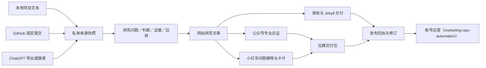

# Research to Publish

[](https://github.com/roy-tong/research-to-publish/actions/workflows/ci.yml)

把本地项目、GitHub 研究与 ChatGPT 会话，转成有来源、有版本、可复核的网站文章与社媒交付包。

这是**内容生产项目**，也是「研究 → 文章 → 公众号/小红书交付 → 账号运营」全链路的**终端应用主体**。作者／AI agent 完成研究整理与写作；CLI 管理采集、检查、构建、审核失效与发布回执。Python 3.9+，运行时零第三方依赖，无需模型 API key。

### 全链路生态位

| 阶段 | 工具 | 与本仓库的接线 |
|---|---|---|
| 深度研究（核心上游） | [SURE / user-demand-research](https://github.com/roy-tong/user-demand-research) | 证据分级报告作为来源快照导入（`ingest case`） |
| 媒体证据 | [bilibili-transcript-pipeline](https://github.com/roy-tong/bilibili-transcript-pipeline) | 逐字稿按来源导入；访谈走 SURE interview-kit 消化 |
| 信源监测（可选） | [iRead](https://github.com/roy-tong/iRead) | 周报/信源清单作为选题输入导入；资源占用大、按需启用 |
| 标的库（可选） | 开源项目研究对象库（本地资产，见 [agent-tool-center](https://github.com/roy-tong/agent-tool-center) 研究线） | 案例「为什么值得研究/机会与内容角度」字段直接作选题素材 |
| 内容生产 | 本仓库 | 来源快照 → 稿件 → 审核 → 三平台交付包 |
| 审稿 gate（两道） | my-voice（[agent-tool-center/skills/my-voice](https://github.com/roy-tong/agent-tool-center/tree/main/skills/my-voice)）+ 对标质量审核 | `review` 前依次过：① 表达底线（去机翻/去AI味/去自造词）② 对标审核（对标博主语感 + 六病因诊断 + 深度配方 + 画像阈值质检；资产在本地内容管线工作台） |
| 账号运营 | [marketing-ops-automation](https://github.com/roy-tong/marketing-ops-automation) | 交付包与文章链接进其发布队列，X / Email 等渠道执行（X 渠道 vendor 自已归档的 x-ops-automation） |

各工具独立可用；接线是数据契约（来源快照、交付包、队列），不做进程级耦合。



## 已实现

- 本地文本导入；GitHub 公开文件按完整 commit SHA 固定；ChatGPT 官方导出按当前对话分支解析，也接受正文摘录封套。
- 私有材料与开源代码分离；来源快照、哈希与来源元数据；同版本幂等导入、配置清单同步。
- `topic.json` 保存研究问题、判断、引文和边界；`editorial.json` 保存三平台独立稿件；`brief.md` 提供完整 agent 写作输入。
- 检查引文确实存在、段落关联已知判断；拒绝把 ChatGPT 当作事实的独立证明。
- 构建 Jekyll Markdown、公众号内联样式 HTML、小红书文案 JSON／Markdown、1080×1440 SVG 卡片与整包预览。
- 审核绑定内容指纹，来源或稿件更新即失效；导出检查上游变更与构建篡改；网站文章不覆盖已有文件。
- 发布回执与待修订提示；配套 Skill、合成端到端示例、测试和 GitHub Actions CI。

## v0.2：补齐编辑决策与反馈

支持按专题选择渠道，保留未选草稿但不强制生成三端内容。反馈可分类导入、处理和查询；未解决的反证阻止该专题审核与导出。`impact` 可跨专题查询来源复用、受影响段落和已发版本。

阅读 [内容体系](docs/editorial-system.md) 与 [命令及升级说明](docs/feedback.md)。这是可追踪的人工编辑闭环，不是自动分析平台数据。

## 五分钟跑通

在仓库根目录运行，无需安装：

```bash
python3 examples/demo.py --workspace /tmp/r2p-demo
python3 -m research_to_publish --workspace /tmp/r2p-demo status one-research-three-readers
python3 -m unittest discover -s tests -v
```

打开打印路径下的 `preview.html` 查看三平台内容；`manifest.json` 查看段落关联和来源版本。示例全部为合成材料，不自动审核、不发布。

也可 `python3 -m pip install -e .`，之后用 `r2p` 代替 `python3 -m research_to_publish`。

## 真实生产

代码仓库与私有工作台使用不同目录。以下路径、来源 ID 和 commit 是占位，使用前替换：

```bash
r2p --workspace /work/editorial init
r2p --workspace /work/editorial ingest case --file /work/my-project/report.md
r2p --workspace /work/editorial ingest chat --file /work/exports/conversations.json --chatgpt --conversation-id ACTUAL_ID
r2p --workspace /work/editorial ingest github --github OWNER/REPO --ref FULL_40_CHAR_COMMIT_SHA --path docs/research.md --public-url https://example.com/research/
r2p --workspace /work/editorial topic my-research --title '研究题目' --question '要回答什么？' --sources case chat github
r2p --workspace /work/editorial brief my-research
```

由 agent 按 [配套 Skill](skills/research-to-publish/SKILL.md) 读取 `brief.md`，先整理判断，再写网站研究，最后写两份平台稿。结构参考 `examples/demo.py`。CLI 不会把模板拼接冒充原创研究，也不会自动向 ChatGPT 发提示词。

```bash
r2p --workspace /work/editorial validate my-research
r2p --workspace /work/editorial build my-research
# 检查完预览、事实、来源与公开范围后记录；正式 review 前稿件先过两道审稿 gate（my-voice 表达底线 + 对标质量审核）
r2p --workspace /work/editorial review my-research --reviewer '实际复核者' --note '说明检查范围'
r2p --workspace /work/editorial export my-research --to /work/releases/my-research-v1 --site-repo /work/existing-jekyll-site
```

`export` 只写本地站点文章和社媒交付包，不代表已提交、推送、部署或发布。正式流程见 [发布与回执](docs/publishing.md)。持续接入使用 `sync --config /work/sources.local.json`，见 [来源接入](docs/sources.md)。

## 三种内容

| 输出 | 内容要求 |
|---|---|
| 网站 | 问题、完整证据、推理、反证、边界、公开引用 |
| 公众号 | 核心专业用户的独立论证与行业含义，不商业化 |
| 小红书 | 广泛和初阶用户的具体问题、独立答案、清晰图文结构 |

默认作者目标：传播与个人知名度优先，其次专业认可，最后商业收入。其他作者可修改 Skill 中的 brief；工具不硬编码增长指标。

## 适用边界

- v0.2 是 **agent-assisted** 管线，不是无人值守写作／发帖 SaaS。
- 输入支持 UTF-8 文本和已知 ChatGPT JSON；PDF、Word、音视频先用对应工具提取文本，保留原出处。聊天图片与附件未自动读取。
- Chrome 采集依赖宿主 agent 的浏览器能力；不读 cookies、不调用 ChatGPT 私有 API。采集失败可接官方导出或用户摘录，必须如实标注覆盖范围。
- 引文匹配只证明原文含有这句话，不证明它真实或能支持结论；语义、数字与公开范围仍需编辑复核。
- SVG 为可编辑卡片，HTML 为公众号待粘贴稿；平台最终排版需预览。可用内置 `rasterize` 命令导出 PNG（可选 Pillow 依赖），详见发布文档。
- Jekyll 适配写 `_posts`；不会自动改写既有研究档案索引。新增资料须遵守网站自身的资料库维护规则。
- 本地上游可以检测变更；远端／聊天的新版本需要主动重新导入。单作者顺序运行，不支持并发写工作台。

## 仓库结构

`research_to_publish/` CLI · `skills/` agent 工作流 · `examples/` 合成样例 · `tests/` 测试 · `docs/` 接入与发布说明。

MIT 许可覆盖本仓库代码与原创文档，不改变输入材料的权利。真实研究和账号凭据不进入此仓库。
